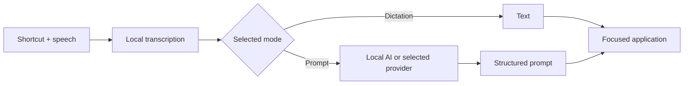

<div align="center">
  
  <h1>VozPrompt</h1>
  <p><strong>From voice to text. From an idea to a prompt.</strong></p>
  <p>Speak naturally, organize with AI, and keep working wherever your cursor is.</p>
  <p><a href="#see-it-in-action">Demo</a> · <a href="#getting-started">Getting started</a> · <a href="#development">Development</a> · <a href="README.md">Português</a></p>
</div>


> **Draft contribution proposal.** This README describes the working copy with the proposed changes, not the current public `main`. Building, installing and starting the app were verified on Windows x64. UI checks ran in a browser; native macOS and Linux builds and QA remain pending. [Technical review and submission plan](docs/CONTRIBUTION-REVIEW.md) (Portuguese).

[VozPrompt / IntegraPrompt](https://github.com/willianomiguel/integraprompt), by **Willian Daniel**, turns dictation into prompts using local models or AI providers. It builds on [Handy](https://github.com/cjpais/Handy), by **CJ Pais**, which provides recording, local transcription, shortcuts and pasting. This contribution preserves those credits and the MIT license.

## See it in action


_UI demonstration using synthetic data and mocked IPC. This shows theme and color changes; it is not a speech-recognition recording or proof of native behavior on any operating system. Screenshots use a customized shortcut profile._

| Light                                        | Dark                                       |
| -------------------------------------------- | ------------------------------------------ |
|  |  |

Keep the original pink palette or choose red, orange, yellow, green, sky blue, blue, indigo or violet. Every accent has light and dark variants. **System** follows the operating system's appearance preference.

## Two ways to use your voice

| Your intent                                | Mode                                   | Result                                                      |
| ------------------------------------------ | -------------------------------------- | ----------------------------------------------------------- |
| Write what you dictated                    | **Transcription**                      | Text recognized by the local speech model                   |
| Turn an idea into an organized instruction | **Transcription with post-processing** | Text processed by the selected provider and prompt template |



**Illustrative example, not a benchmark result:**

> “I need a simple page for my coffee shop, with the menu, address and a WhatsApp contact button. Make it feel welcoming.”

```text
Goal: create a page for a coffee shop.
Content: menu, address and WhatsApp contact.
Visual direction: welcoming, simple and easy to navigate.
Deliverable: page structure and initial copy; identify missing information.
```

Actual output depends on the model, template and input. Existing templates include **General, Programming, Image, Video and Text/copy**; you can edit them or add your own.

## What this proposal adds

- **Clearer interface:** separate dictation and prompt actions, reorganized settings and improved spacing.
- **Personal appearance:** nine accents, light/dark/system themes, persisted settings and synchronization between the main window and overlay.
- **Revised overlay:** a complete border, work states, visible keyboard focus and reduced-motion support. The new drag implementation is Windows-specific and avoids activating the overlay window.
- **Optional audio storage:** keep text history without keeping an audio file. Saving audio is off by default.
- **More time for local AI:** loopback endpoints receive up to 120 seconds; remote providers retain 20 seconds. Handled pipeline failures return the original transcription and report the reason.
- **Windows icons:** the title and running taskbar icons follow the selected accent. The Windows taskbar background still follows Windows settings.

## Getting started

1. Open the app and download a transcription model supporting your language, such as Whisper.
2. Configure the provider, model and template in the AI prompt settings. The project supports local AI, OpenAI, Groq, OpenRouter, Anthropic and compatible APIs.
3. Check both shortcuts in **General**. Activation behavior is configurable: hold, toggle or automatic, according to the app's available options.
4. Place the cursor in your destination app and use the appropriate shortcut.
5. Choose a theme, accent and whether to **save recorded audio**.

### Check your shortcut profile

The **code defaults** still match the original project:

| Action                         | Windows / Linux        | macOS                    |
| ------------------------------ | ---------------------- | ------------------------ |
| Transcribe only                | `Ctrl + Space`         | `Option + Space`         |
| Transcribe and process with AI | `Ctrl + Shift + Space` | `Option + Shift + Space` |

Screenshots use a customized Windows profile with those two shortcuts swapped: `Ctrl + Space` for **prompts**, `Ctrl + Shift + Space` for **dictation**. This is a local preference, not a change to defaults for other users or platforms.

## Privacy and history

Speech recognition uses local models. If you select a remote post-processing provider, **the transcribed text is sent to that provider**. With a local AI server, this step can also run on your computer. Initial model downloads still require internet access.

**Save recorded audio** defaults to off in this proposal, including when older settings do not contain the new field. Text history is still stored. Playback and retranscription are unavailable for entries without audio. Turning the option off **does not delete older recordings**; existing history and retention controls still apply.

Never include personal recordings, history, API keys, models or user settings in a pull request.

## Compatibility and validation

| Platform        | Status of this contribution                                                                                                                                                  |
| --------------- | ---------------------------------------------------------------------------------------------------------------------------------------------------------------------------- |
| **Windows x64** | Release built, installer run and app restarted. Browser UI QA passed. Dragging, focus, mixed DPI and native icons still need full native visual verification.                |
| **macOS**       | Shared UI, settings and pipeline code. Native build, permissions, paste behavior, overlay and Dock remain unverified. No new macOS drag implementation.                      |
| **Linux**       | Shared UI, settings and pipeline code. Native build, X11/Wayland, shortcuts, paste behavior and window-manager behavior remain unverified. No new Linux drag implementation. |

The modified `icon.icns` also changes the packaged macOS logo. Generated mobile icons **do not imply Android/iOS support** and should be excluded from a desktop-focused PR. Base packaging still includes Handy identity and updater settings; distribution requires a maintainer decision. See the [impact matrix and submission plan](docs/CONTRIBUTION-REVIEW.md).

## Development

From a checkout containing this proposal, install the platform prerequisites in [BUILD.md](BUILD.md): Rust, Bun and native build tooling. Windows x64 additionally requires C++ Build Tools, CMake, Vulkan SDK and WebView2.

```bash
bun install --frozen-lockfile
```

Prepare the required VAD resource, as documented in [AGENTS.md](AGENTS.md):

```bash
mkdir -p src-tauri/resources/models
curl -L -o src-tauri/resources/models/silero-vad-v6.2-F32.gguf https://huggingface.co/handy-computer/silero-vad-v6.2-gguf/resolve/main/silero-vad-v6.2-F32.gguf
```

In PowerShell, use `New-Item -ItemType Directory -Force src-tauri/resources/models` and `curl.exe` for the download.

```bash
bun run dev                # frontend; native features require Tauri
bun run tauri dev          # desktop app
bun run build              # TypeScript + frontend build
cargo test --manifest-path src-tauri/Cargo.toml -p vozprompt-core
```

For this proposal's local Windows variant:

```powershell
powershell -NoProfile -ExecutionPolicy Bypass -File scripts/windows.ps1 -Action Dev
powershell -NoProfile -ExecutionPolicy Bypass -File scripts/windows.ps1 -Action Build
```

The script uses `tauri.local-windows.conf.json`, disables the local variant's updater and creates an NSIS installer. It **does not install every prerequisite or configure local AI automatically**. The auxiliary AI launcher assumes installation-specific paths and a fixed port; it is not a portable distribution integration.

### Checks and UI preview

```bash
bun run lint
bun run check:translations
bun run format:check
```

Translation and formatting checks currently have outstanding findings in the [review](docs/CONTRIBUTION-REVIEW.md). This proposal is not merge-ready until those are resolved.

With `bun run dev` running, open `/design-preview.html` for a synthetic-data UI preview. `node scripts/qa-appearance.mjs` runs appearance regressions; it needs installed Chrome and the server at `127.0.0.1:1420`. This preview does not exercise native recording, pasting or AI.

## Contributing

Prefer small reviews: **loopback timeout**, **optional audio history**, and **appearance/persistence**, with Windows dragging and visual documentation separated where practical. The proposed logo remains subject to maintainer acceptance.

The existing [PR template](.github/PULL_REQUEST_TEMPLATE.md), inherited from Handy, requests one change per PR, manual submission and a human-written description. No PR, release or push was created by this preparation.

- [Technical review and next steps](docs/CONTRIBUTION-REVIEW.md)
- [Architecture](docs/ARCHITECTURE.md) · [Decisions](docs/DECISIONS.md) · [Project backlog](docs/PENDENCIAS.md)
- [AI assistant guide](docs/PROMPT-IA.md)
- [Media provenance and reproduction](docs/media/README.md)

## License and credits

[MIT](LICENSE). Copyright © 2025 **CJ Pais** and © 2026 **Willian Daniel**, as recorded in the existing license. Proposed visual and platform contributions do not replace original project authorship. Development and documentation assistance: Codex.
