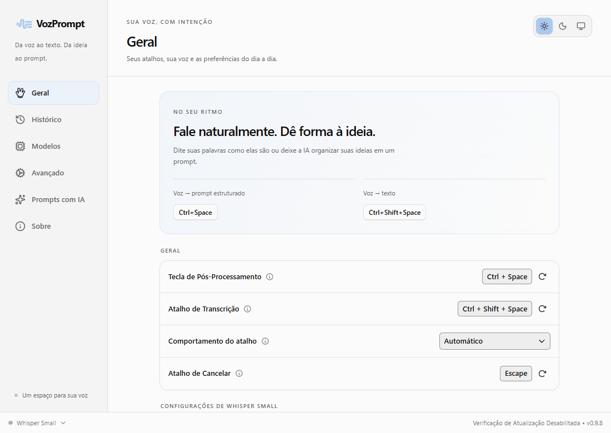
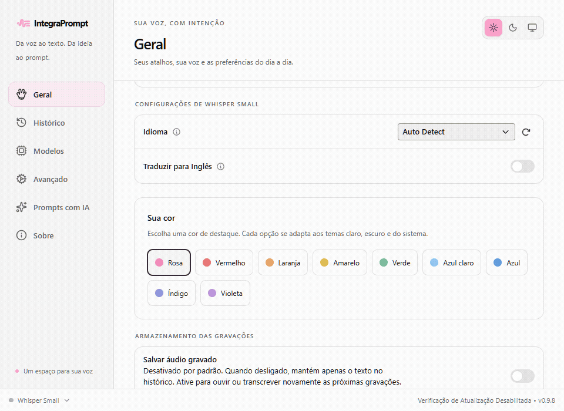
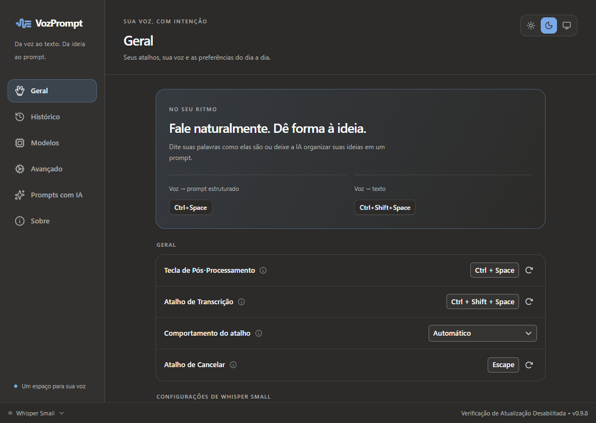
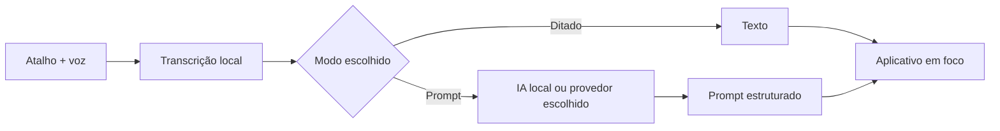

<div align="center">
  
  <h1>VozPrompt</h1>
  <p><strong>Da voz ao texto. Da ideia ao prompt.</strong></p>
  <p>Fale com naturalidade, organize com IA e continue trabalhando onde o cursor estiver.</p>
  <p><a href="#veja-em-ação">Demonstração</a> · <a href="#comece-a-usar">Como usar</a> · <a href="#desenvolvimento">Desenvolvimento</a> · <a href="README.en.md">English</a></p>
</div>



> **Proposta de contribuição, ainda não publicada.** Este README descreve o checkout com as melhorias propostas, que ainda não estão na `main` pública. Build, instalação e inicialização foram verificados no Windows x64. A interface foi testada em navegador; macOS e Linux ainda precisam de build e QA nativos. [Avaliação completa](docs/CONTRIBUTION-REVIEW.md).

O [VozPrompt / IntegraPrompt](https://github.com/willianomiguel/integraprompt), de **Willian Daniel**, transforma ditado em prompts com modelos locais ou provedores de IA. É um fork do [Handy](https://github.com/cjpais/Handy), de **CJ Pais**, que fornece a base de gravação, transcrição local, atalhos e colagem. Esta contribuição preserva esses créditos e a licença MIT.

## Veja em ação



_Demonstração da interface com dados fictícios e IPC simulado: alternância de temas e cores. Não é uma gravação de reconhecimento de voz nem uma prova do funcionamento nativo no Windows, macOS ou Linux. Os atalhos mostrados nas capturas são um perfil personalizado._

| Claro                                   | Escuro                                  |
| --------------------------------------- | --------------------------------------- |
|  |  |

A proposta mantém a paleta rosa original como opção e acrescenta vermelho, laranja, amarelo, verde, azul claro, azul, índigo e violeta. Cada cor possui variações para os temas claro e escuro; a opção **Sistema** acompanha a preferência do sistema operacional.

## Duas maneiras de usar sua voz

| Você quer…                                      | Use…                                  | Resultado                                                               |
| ----------------------------------------------- | ------------------------------------- | ----------------------------------------------------------------------- |
| Escrever exatamente a ideia que ditou           | **Transcrição**                       | Texto reconhecido pelo modelo local                                     |
| Transformar a ideia em uma instrução organizada | **Transcrição com pós-processamento** | Texto enviado ao provedor escolhido e estruturado pelo modelo de prompt |



**Exemplo ilustrativo — não é um resultado de benchmark:**

> “Quero uma página simples para minha cafeteria. Precisa mostrar o cardápio, o endereço e um botão para falar no WhatsApp. O visual deve ser acolhedor.”

```text
Objetivo: criar uma página para uma cafeteria.
Conteúdo: cardápio, endereço e contato pelo WhatsApp.
Direção visual: acolhedora, simples e fácil de navegar.
Entrega: estrutura da página e textos iniciais; indicar informações faltantes.
```

A resposta real depende do modelo, do template e do que você disser. Os templates do projeto incluem **Geral, Programação, Imagem, Vídeo e Texto/copy**; você pode editar ou criar os seus.

## O que esta proposta acrescenta

- **Interface mais clara:** diferencia ditado e prompt, reorganiza as preferências e melhora o enquadramento.
- **Aparência pessoal:** nove cores, claro/escuro/sistema, preferências salvas em disco e sincronização entre janela e popup.
- **Popup revisado:** borda completa, estados de trabalho, foco visível e respeito à redução de movimento. O novo arraste sem ativar a janela foi implementado especificamente para Windows.
- **Áudio opcional:** manter a transcrição no histórico sem guardar um arquivo de áudio. O salvamento de áudio começa desativado.
- **Mais tempo para IA local:** endpoints de loopback recebem até 120 segundos; provedores remotos continuam com 20 segundos. Nas falhas tratadas pelo pipeline, o resultado volta à transcrição original e informa o motivo.
- **Ícones no Windows:** a logo da janela e o ícone da barra de tarefas acompanham a cor selecionada. Isso não altera o tema da barra de tarefas do próprio Windows.

## Comece a usar

1. Abra o app e baixe um modelo de transcrição compatível com seu idioma, como Whisper.
2. Em **Prompts com IA**, configure o provedor, o modelo e um template. O projeto oferece IA local e integrações como OpenAI, Groq, OpenRouter, Anthropic e APIs compatíveis.
3. Confirme os dois atalhos em **Geral**. O modo de ativação é configurável: segurar, alternar ou automático, conforme as opções do app.
4. Coloque o cursor no aplicativo de destino e use o atalho do modo desejado.
5. Ajuste tema, cor e **Salvar áudio gravado** nas preferências.

### Atalhos: confira o seu perfil

Os **padrões do código** continuam sendo os do projeto original:

| Ação                           | Windows / Linux         | macOS                     |
| ------------------------------ | ----------------------- | ------------------------- |
| Apenas transcrever             | `Ctrl + Espaço`         | `Option + Espaço`         |
| Transcrever e processar com IA | `Ctrl + Shift + Espaço` | `Option + Shift + Espaço` |

As capturas usam um perfil Windows personalizado com esses dois atalhos invertidos: `Ctrl + Espaço` para **prompt**, `Ctrl + Shift + Espaço` para **ditado**. Essa escolha foi salva nas configurações locais; ela não mudou os padrões do código nem os atalhos dos demais usuários.

## Privacidade e histórico

A transcrição usa os modelos locais. Ao escolher um provedor remoto para pós-processamento, **o texto transcrito é enviado a esse provedor**. Com um servidor de IA local, essa etapa também pode acontecer na máquina; os downloads iniciais de modelos ainda precisam de internet.

**Salvar áudio gravado** está desativado por padrão nesta proposta, inclusive quando uma configuração antiga não possui essa opção. O histórico continua guardando o texto. Sem o áudio, ouvir novamente ou retranscrever aquela entrada não fica disponível. Desativar a opção **não apaga gravações antigas**; elas continuam sujeitas aos controles existentes de histórico e retenção.

Não coloque áudios pessoais, histórico, chaves de API, modelos ou arquivos de configuração do usuário em um PR.

## Compatibilidade: o que foi validado

| Plataforma      | Situação desta contribuição                                                                                                                                                                                           |
| --------------- | --------------------------------------------------------------------------------------------------------------------------------------------------------------------------------------------------------------------- |
| **Windows x64** | Release compilado, instalador executado e app reaberto. QA de aparência em navegador. Arraste, foco, DPI misto e ícones ainda pedem confirmação visual nativa completa.                                               |
| **macOS**       | Interface, preferências e pipeline compartilham o código. Build nativo, permissões, colagem, popup e Dock ainda não validados. Não há implementação nova de arraste para macOS.                                       |
| **Linux**       | Interface, preferências e pipeline compartilham o código. Build nativo, X11/Wayland, atalhos, colagem e comportamento do gerenciador de janelas ainda não validados. Não há implementação nova de arraste para Linux. |

A alteração de `icon.icns` também muda a logo empacotada no macOS. Ícones móveis foram gerados pela ferramenta, mas **não representam suporte a Android/iOS** e são candidatos a ficar fora do PR. A base de empacotamento ainda contém identidade e atualização herdadas do Handy; a publicação precisa da decisão do mantenedor. [Matriz de impacto e plano de contribuição](docs/CONTRIBUTION-REVIEW.md).

## Desenvolvimento

Na raiz de um checkout que contenha esta proposta, instale as dependências descritas em [BUILD.md](BUILD.md): Rust, Bun e as ferramentas nativas da plataforma. O Windows x64 também requer Build Tools C++, CMake, Vulkan SDK e WebView2.

```bash
bun install --frozen-lockfile
```

Prepare o recurso VAD obrigatório, conforme [AGENTS.md](AGENTS.md):

```bash
mkdir -p src-tauri/resources/models
curl -L -o src-tauri/resources/models/silero-vad-v6.2-F32.gguf https://huggingface.co/handy-computer/silero-vad-v6.2-gguf/resolve/main/silero-vad-v6.2-F32.gguf
```

No PowerShell, use `New-Item -ItemType Directory -Force src-tauri/resources/models` e `curl.exe` para o download.

```bash
bun run dev                # frontend; as funções nativas precisam do Tauri
bun run tauri dev          # aplicativo desktop
bun run build              # TypeScript + build da interface
cargo test --manifest-path src-tauri/Cargo.toml -p vozprompt-core
```

Para a variante Windows local desta proposta:

```powershell
powershell -NoProfile -ExecutionPolicy Bypass -File scripts/windows.ps1 -Action Dev
powershell -NoProfile -ExecutionPolicy Bypass -File scripts/windows.ps1 -Action Build
```

Esse script usa `tauri.local-windows.conf.json`, desativa o updater da variante local e produz um instalador NSIS. Ele **não instala sozinho todas as ferramentas nem configura a IA local**. O launcher auxiliar de IA usa diretórios e porta definidos para a instalação local e não é uma integração portátil pronta para distribuição.

### Verificação e prévia visual

```bash
bun run lint
bun run check:translations
bun run format:check
```

Os dois últimos checks têm pendências registradas na [avaliação](docs/CONTRIBUTION-REVIEW.md). Não trate esta proposta como pronta para merge enquanto elas não forem resolvidas.

Com `bun run dev` ativo, abra `/design-preview.html` para a interface com dados fictícios. `node scripts/qa-appearance.mjs` executa a regressão de aparência; requer Chrome instalado e o servidor em `127.0.0.1:1420`. Essa prévia não executa gravação, colagem ou IA nativa.

## Contribuir com cuidado

A proposta será mais fácil de avaliar em partes: **correção do timeout**, **histórico com áudio opcional** e **interface/aparência**, mantendo o arraste Windows e a documentação em mudanças próprias quando possível. A nova logo é uma proposta sujeita à aceitação do mantenedor.

O [template de PR](.github/PULL_REQUEST_TEMPLATE.md), herdado do Handy e ainda presente neste repositório, pede uma mudança por PR, abertura manual e descrição escrita pelo autor. Este checkout não abriu PR, não criou release e não foi enviado ao GitHub.

- [Avaliação técnica e próximos passos](docs/CONTRIBUTION-REVIEW.md)
- [Arquitetura](docs/ARCHITECTURE.md) · [Decisões](docs/DECISIONS.md) · [Pendências do projeto](docs/PENDENCIAS.md)
- [Guia para usar com um assistente de IA](docs/PROMPT-IA.md)
- [Proveniência e reprodução das imagens](docs/media/README.md)

## Licença e créditos

[MIT](LICENSE). Copyright © 2025 **CJ Pais** e © 2026 **Willian Daniel**, conforme a licença existente. A contribuição visual e as adaptações propostas não substituem a autoria do projeto original. Assistência de desenvolvimento e documentação: Codex.
